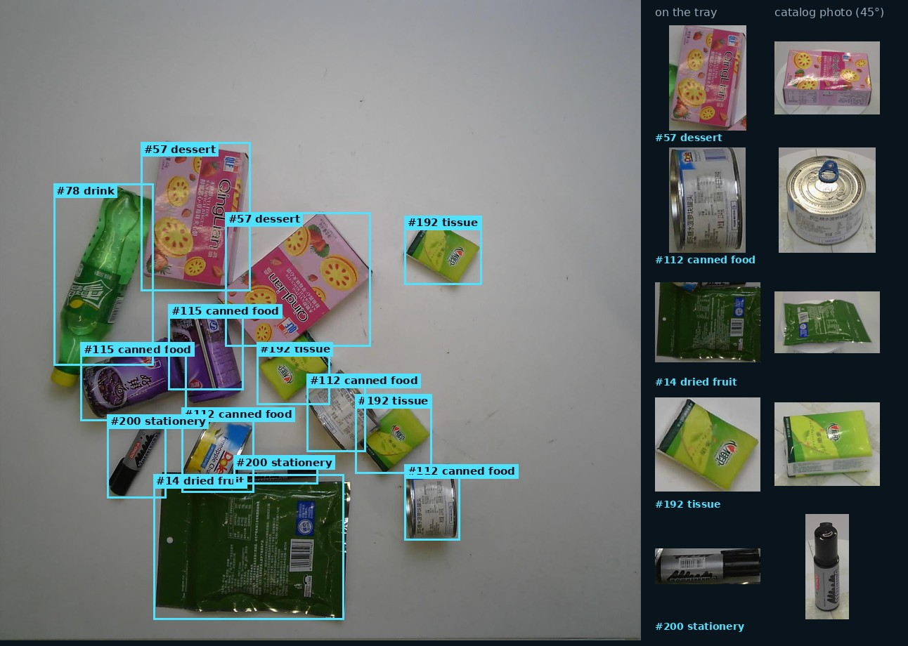
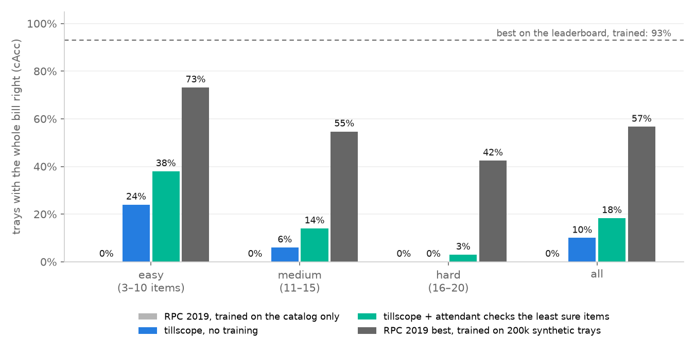
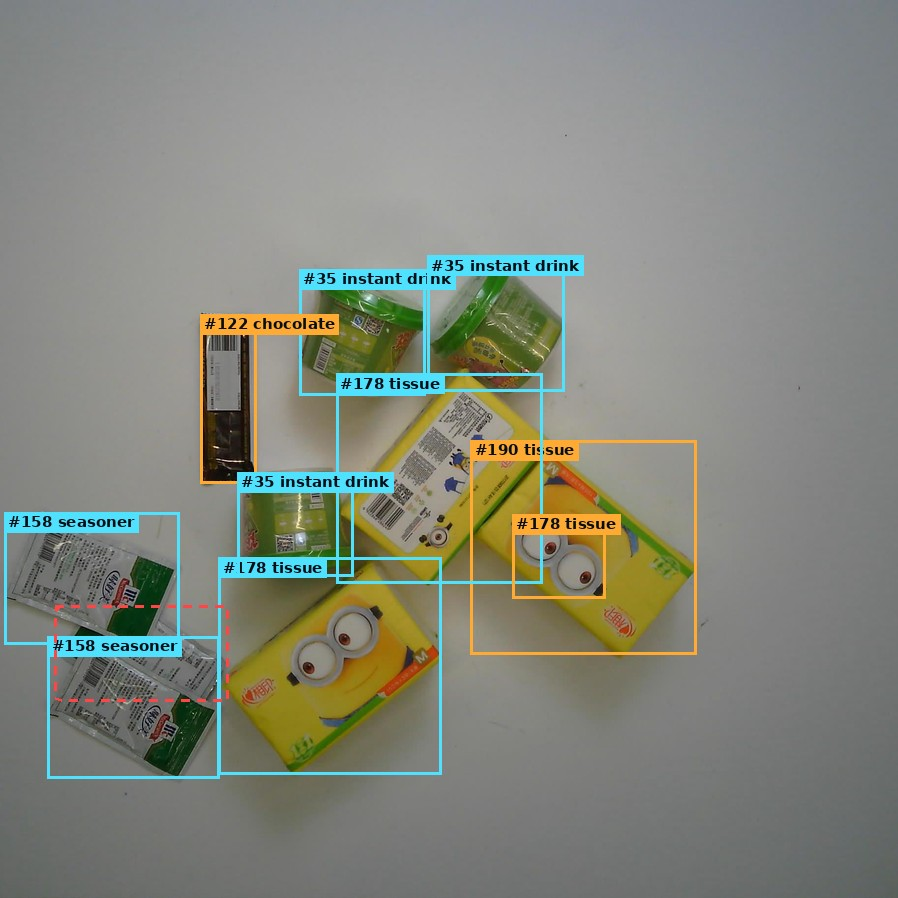
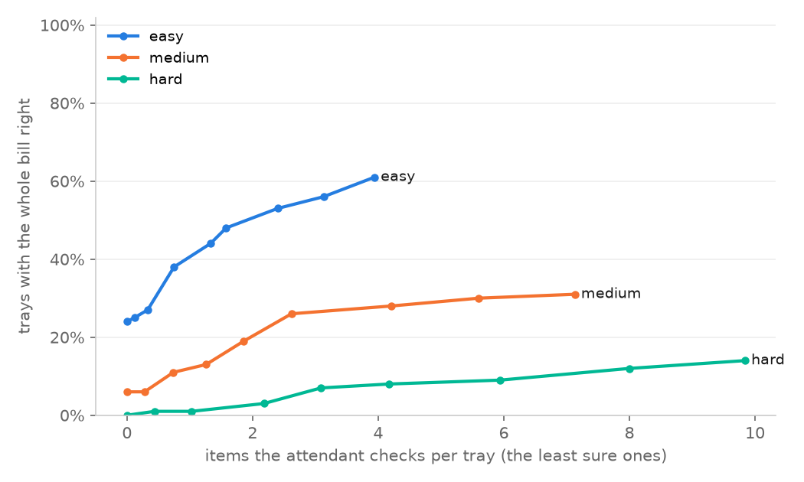
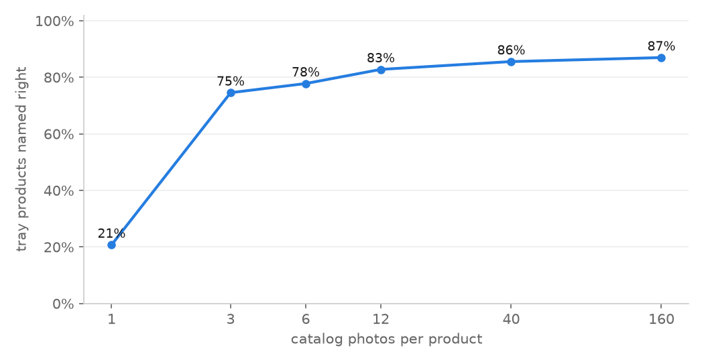
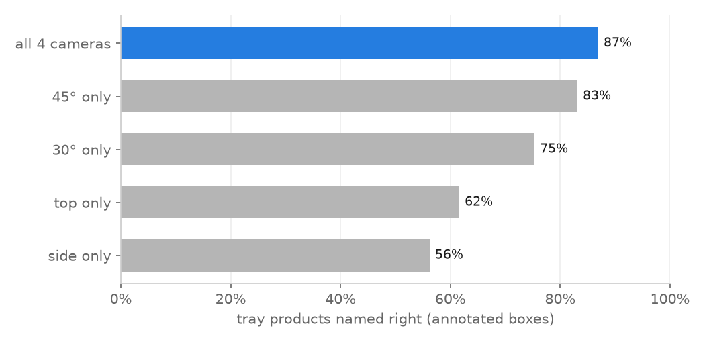
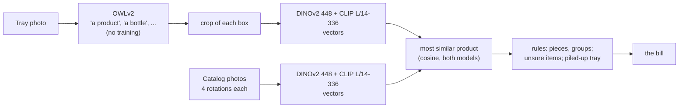

# tillscope: can the camera check the checkout tray with catalog photos only?

🌐 **English** · [Português (Brasil)](README.pt-BR.md)

**One camera above the checkout, 200 products, no training. It finds every item on the tray, names it by comparing with catalog photos, and builds the bill.**

> A personal study by **Claudio Escudero** ([claudioescudero.com](https://claudioescudero.com) · [linkedin.com/in/claudioescudero](https://www.linkedin.com/in/claudioescudero/)). It is not a product or a library.

<p align="center"></p>
<sub>A medium test tray read right: 14 products, no training. Right: what the camera saw and a catalog photo of the product it named. Images: RPC dataset, CC BY-NC-SA 4.0.</sub>

**The question:** self-checkouts and "just put it on the counter" stores need a camera that knows what is on the tray. The usual way is to train a detector on thousands of photos of checkouts. If a store only had its **catalog photos** (each product alone, in a studio), could open models do it with no training at all, and say when they are unsure?

**Short answer:** the camera names **87% of the products right** without being trained on a single checkout photo (90 of them only set the thresholds). But a bill is only right when *every* item is, and 87% per item over 13 items is rarely a whole bill. On 300 test trays the whole bill came out right **10%** of the time (24% on easy trays). The 2019 model trained on the same catalog photos got 0.01%; models trained on 200,000 synthetic checkouts got 57% to 93%. Two cheap fixes help: the attendant checks the 1 or 2 least sure items per tray (18%), and the camera asks to spread out piled-up products before reading (45% of the trays it accepts are right).

## Results

Every choice (models, thresholds, the attendant's margin, when to ask to spread the products) was made on 90 validation trays. The numbers are on 300 **test** trays, 100 per clutter level, 3,899 products.

| | easy | medium | hard | all |
|---|---|---|---|---|
| Products found by OWLv2 | 92.6% | 91.4% | 88.5% | 90.3% |
| Extra boxes per tray (pieces, doubles) | 0.90 | 2.06 | 3.65 | 2.20 |
| Products named right, with the annotated boxes | 88.9% | 88.0% | 85.2% | **86.9%** |
| Products named right, full pipeline | 84.2% | 83.5% | 78.7% | 81.4% |
| Item count right | 50% | 36% | 13% | 33% |
| **Whole bill right (cAcc)** | **24%** | **6%** | **0%** | **10%** |
| Whole bill right if every box were perfect | 43% | 21% | 8% | 24% |
| Items the attendant checks per tray | 0.79 | 1.32 | 2.23 | 1.45 |
| Whole bill right after the attendant | 38% | 14% | 3% | 18% |

<p align="center"></p>

**Against the RPC benchmark** (cAcc, the share of trays with the whole bill right):

| Method | Trained on | easy | medium | hard | all |
|---|---|---|---|---|---|
| RPC 2019, "Single" (paper, Table 3) | the 53,739 catalog photos | 0.02% | 0.00% | 0.00% | 0.01% |
| **tillscope** | nothing | 24% | 6% | 0% | 10% |
| tillscope + attendant checks 1.45 items per tray | nothing | 38% | 14% | 3% | 18% |
| RPC 2019 baseline, "Syn+Render" (paper, Table 3) | catalog + 200k synthetic checkouts | 73.17% | 54.69% | 42.48% | 56.68% |
| CommNet v2, 2021 ([leaderboard](https://github.com/RPC-Dataset/RPC-Leaderboard)) | catalog + synthetic checkouts | | | | 93.11% |

The protocols are not identical: tillscope uses a 300-tray sample, and its levels are binned by item count (the Hugging Face copy has no level field). The gap is still clear: with only catalog photos, open models today beat the 2019 catalog-only detector by far, and they remain far from the models trained on synthetic checkouts.

### Where the bill goes wrong

Of the 270 test trays with a wrong bill, **177 missed a product**, 55 had an extra box (a piece of a product, or one product counted twice) and 38 had every box right with one wrong name. With perfect boxes the whole bill would be right on 24% of the trays, not 10%: finding the products costs as much as naming them.

<p align="center"></p>
<sub>Cyan: right. Amber: wrong name, or a box that is not a product. Red dashed: a product the camera missed. Here: two tissue packs of the same brand swapped, a cartoon face on a pack boxed as a product, a sachet under another one missed.</sub>

Products are missed mostly when they lie **under another product**, when the bag is transparent, and when they are flat (notebooks). On wrong names, 46% go to a product of the same group (for example chocolate bar #133 read as #131, gum #137 as #136): RPC has look-alike variants of one brand. Chocolate (74% right) and gum (76%) are the hardest groups; drinks are the easiest (95%).

### The attendant and "please spread the products"

<p align="center"></p>

Each name comes with a **margin**: how far the best product is ahead of the second. The attendant checks the items with the smallest margin. A checked item gets its right name, and a checked box that is not a product is deleted. Checking 10% of the items (0.8 per easy tray) takes easy trays from 24% to 38%; checking 4 per tray takes them to 61%. Missed products cannot be fixed this way, which is why the curves flatten.

When a box lies at least half inside another, products are piled up, and the camera **asks to spread them out** instead of reading the tray. The 50% threshold was the one that best separated wrong bills from right ones on validation. RPC trays are crowded on purpose, so the rule sends back most of them: it accepts 24% of the test trays (46% of the easy ones), and on those the bill is right 45% of the time after the attendant, against 18% over all trays.

### What names a product best

Products named right on the test trays, with the annotated boxes (so detection does not get in the way):

| Vectors | 12 catalog photos per product | Whole catalog (~270 per product) |
|---|---|---|
| DINOv2 base, 224 px | 59.4% | |
| DINOv2 large / giant, 224 px | 59.3% / 57.6% | |
| DINOv2 base / large, 448 px | 66.5% / 66.7% | 71.4% (base) |
| CLIP ViT-B/32 | 69.1% | |
| CLIP ViT-L/14-336 | 76.8% | 83.4% |
| **DINOv2 base 448 + CLIP L/14-336** | 83.2% | **86.9%** |

- **CLIP beat DINOv2**, the opposite of [skuscope](https://github.com/escudero/skuscope), where DINOv2 separated look-alike products on a shelf photo. Here the catalog is a studio and the tray is another scene, under other light and seen from another angle. CLIP, which learned from captions, copes better with that change. The two together beat either one: they get different products wrong.
- **For DINOv2, resolution mattered and size did not.** Going from 224 to 448 px gained 7 points (small print and logos); going from base to giant gained nothing.
- **Rotating the catalog photos** by 90°, 180° and 270° gained 4 points (86.9% against 83.2%): on the tray, products lie at any angle.

<p align="center">
  
  
</p>

- **More catalog photos, better names:** 1 photo per product names 21% of the products, 12 name 83%, 160 or more 87%.
- **The top camera is not the best one.** One of the four catalog cameras looks straight down, like the checkout camera, but alone it names only 62%. On the turntable a bottle stands up, and from the top it is a cap; on the tray it lies down and looks like the side view. The 45° camera alone gets 83%. All four together get 87%.

## What went wrong

| Finding | What changed |
|---|---|
| The idea assumed the catalog was all side views; one of RPC's four cameras looks from the top | It became a test: the top camera alone is worse than the 45° one, and all four are best |
| DINOv2 base named 59% of the products, and the bill was right on fewer than 8% of the validation trays | CLIP, 448 px, the pair and the whole catalog: 87% |
| A bigger DINOv2 (giant, 1.1B parameters) did not help | Resolution did |
| OWLv2 boxed pieces of products (a cartoon face on a pack) and groups of products | A box holding two boxes it is less sure of is a group, dropped; a less sure box inside a box with the same name is a piece, dropped |
| Products under other products are missed, and one missing item ruins the bill | Not fixed by the detector: the camera asks to spread the products |
| OWLv2 misses flat notebooks ("a product" and "a package" do not cover them) | Adding "a notebook", "a pen", "a tube" and "a pouch" halved the missed stationery on validation (16 → 8) but raised overall recall by only 0.7 points, so the 8 prompts stayed |
| OWLv2's class-agnostic "objectness" score as the finder | Worse than the text prompts on 15 validation trays: not used |
| The Hugging Face rows API answered 429 after a burst of photo downloads (the photo links count too) | One request every 0.4 s, with the Hugging Face token when there is one |
| RPC photographs each basket two or three times, rearranged | One photo per basket in the sample |
| The laptop had about 0.7 GB of free memory at times | Detection and the first vectors ran on its CPU; the bigger models and the whole catalog ran on a free Kaggle T4 |

## The data

| Data | What the study uses | Download | License |
|---|---|---|---|
| [RPC, Retail Product Checkout](https://rpc-dataset.github.io/) ([arXiv 1901.07249](https://arxiv.org/abs/1901.07249)) | 2,400 catalog photos (12 per product: 3 from each of the 4 cameras) and 390 checkout trays (90 validation, 300 test), ~0.4 GB; for the whole-catalog runs, all 53,739 catalog photos (9.2 GB, read on Kaggle) | The free Hugging Face copy [`benjamintli/retail-product-checkout`](https://huggingface.co/datasets/benjamintli/retail-product-checkout), photo by photo, with [`01_fetch.py`](scripts/01_fetch.py) | CC BY-NC-SA 4.0 |

RPC has 200 products from 17 groups (drinks, instant noodles, tissues, candy...), photographed two ways:

- **Catalog:** one product at a time on a turntable, by four cameras (side, 30°, 45° and top), every 9°; boxes and bags twice, one pass per side. 53,739 photos in all.
- **Checkout:** a camera above an 80 × 80 cm white board, with 3 to 20 products dropped on it. 30,000 trays in three clutter levels, each product labeled with its box and name.

Three things about the data shaped the study:

- **The Hugging Face copy has no clutter level.** RPC defines it by items per tray (easy 3–10, medium 10–15, hard 15–20); the ranges touch, so trays are binned by count: easy ≤ 10, medium 11–15, hard ≥ 16.
- **Each basket was photographed two or three times**, rearranged on the board. The sample keeps one photo per basket, so no purchase counts twice.
- **Product names are anonymous** (`35_instant_drink`), which is why the images show numbers.

## How it works



1. **Find.** OWLv2 is an open-vocabulary detector: it finds objects from text prompts, here "a product", "a package", "a bottle", "a box", "a bag", "a cup", "a chocolate bar" and "a can". Nothing about these 200 products is taught to it.
2. **Fingerprint.** Each box is cropped (plus 4% around it), padded to a square and turned into two vectors, one by DINOv2 at 448 px and one by CLIP ViT-L/14 at 336 px. Each catalog photo is cropped by its RPC box the same way, in four rotations.
3. **Name.** Each crop is compared with every catalog photo by cosine similarity; a product's score is its best photo. The two models' scores are put on one scale (each standardized by its mean and spread on validation) and averaged. The gap between the best and the second-best product is the **margin**.
4. **Clean up.** A box holding two or more boxes that OWLv2 is surer of is a group, dropped. A less sure box inside a bigger box with the same name is a piece, dropped. A box inside a box with a *different* name stays: that is a product on top of another. A box OWLv2 is unsure of (below 0.3) still counts when it looks a lot like a catalog product.
5. **Bill.** Count the names. Items with a margin under the validation threshold go to the attendant; a tray where a box lies half inside another is sent back to be spread out.

| Model | Job | Trained on |
|---|---|---|
| **OWLv2** base, patch 16, ensemble ([`google/owlv2-base-patch16-ensemble`](https://huggingface.co/google/owlv2-base-patch16-ensemble)) | Find every product from text prompts | CLIP backbone, then self-training on web images (WebLI) with pseudo-boxes, plus public detection datasets |
| **DINOv2** base ([`facebook/dinov2-base`](https://huggingface.co/facebook/dinov2-base)), at 448 px | Vectors that see visual detail | LVD-142M, images only (self-supervised) |
| **CLIP** ViT-L/14-336 ([`openai/clip-vit-large-patch14-336`](https://huggingface.co/openai/clip-vit-large-patch14-336)) | Vectors that see what the object is | 400M image–text pairs |
| Compared, not used in the end | DINOv2 large and giant ([`facebook/dinov2-large`](https://huggingface.co/facebook/dinov2-large), [`facebook/dinov2-giant`](https://huggingface.co/facebook/dinov2-giant)), CLIP ViT-B/32 ([`openai/clip-vit-base-patch32`](https://huggingface.co/openai/clip-vit-base-patch32)) | |

All are off the shelf; none was trained or fine-tuned for this study.

## How to reproduce

**Requirements:** Linux or macOS, Python 3.12, [uv](https://docs.astral.sh/uv/). The 12-photo catalog runs on a CPU; the whole catalog wants a GPU.

```bash
# 1. environment (CPU build of PyTorch; on a GPU machine use the CUDA build)
uv venv --python 3.12 .venv && source .venv/bin/activate
uv pip install -r requirements.txt --extra-index-url https://download.pytorch.org/whl/cpu

# 2. data (~0.4 GB)
python scripts/01_fetch.py index      # labels of all 83,739 rows, JSON only (~45 min, paced)
python scripts/01_fetch.py select     # 12 catalog photos per product, 390 trays
python scripts/01_fetch.py download   # the photos (~40 min, paced)

# 3. the study
python scripts/02_detect.py                              # OWLv2: 4.6 s per tray on a 16-thread CPU
python scripts/03_embed.py dinov2-448 clip-large-336     # vectors of every crop (GPU: ~25 min on a T4)
python scripts/03b_embed_full_catalog.py dinov2-448      # optional, the whole catalog (T4: 99 min)
python scripts/03b_embed_full_catalog.py clip-large-336  # optional (T4: 126 min)
python scripts/04_recognize.py                           # choices on validation, the bills
python scripts/05_evaluate.py                            # the numbers, on test
python scripts/06_figures.py                             # the images of this README
```

`03_embed.py` with no names runs every model of the comparison table. The models download from Hugging Face on first use (OWLv2 0.62 GB, DINOv2 base 0.35 GB, CLIP L/14-336 1.7 GB). The rows API answers 429 when pushed, so `01_fetch.py` paces itself (one request every 0.4 s) and uses your Hugging Face token when you are logged in (`hf auth login`). `03b_embed_full_catalog.py` reads the 19 catalog Parquet files (9.2 GB) one at a time and deletes each after use; it needs `pyarrow`. Output goes to `data/output/`.

**On a free Kaggle GPU:** [`scripts/kaggle/run_on_kaggle.py`](scripts/kaggle/run_on_kaggle.py) uploads the scripts, the labels and the photos already downloaded as a private dataset, runs step 3 (or 3b with `--full <model>`) in a private notebook on a T4, waits and downloads the vectors. It needs the Kaggle CLI with your credentials. In this study, steps 1, 2 and the DINOv2 base and CLIP B/32 vectors ran on a laptop CPU; the other vectors ran on Kaggle.

### Trying your own photos

[`scripts/tillscope.py`](scripts/tillscope.py) runs the whole pipeline on your own catalog and tray photos. It needs only the environment; the thresholds come from `data/output/config.json` when you ran the study, else from the study's values.

```bash
# a folder per product, a few photos each, from several angles (45° helps most)
python scripts/tillscope.py build-catalog my_catalog/ --out my_catalog.npz

# read a tray; with --expect, compare it with what was rung up (one product name per line)
python scripts/tillscope.py check tray.jpg --catalog my_catalog.npz --expect receipt.txt --out checked.jpg
```

An honest example: a test tray with 5 products, a catalog of their 12 RPC photos each, the lighter pair (`--models dinov2+clip`) and the right receipt:

```
5 products on the tray
  3 x 107_milk
  1 x 13_dried_fruit
  1 x 147_candy
! on the tray but not rung up: 1 x 107_milk
! rung up but not seen on the tray: 1 x 170_personal_hygiene
```

The toothpaste box (`170`) was read as a milk carton, so a right receipt raised a false alarm. This is the case for the attendant: in `checked.jpg`, items with a small margin are drawn in amber to be confirmed. When products are piled up, it asks to spread them out.

## Repository layout

```
scripts/
  01_fetch.py … 06_figures.py   reproduce the study, one step each, parameters at the top
  03b_embed_full_catalog.py     optional: vectors of the whole catalog (GPU)
  tray.py                       naming, clean-up rules, bill and matching (shared)
  tillscope.py                  use it on your own catalog and tray photos
  kaggle/                       optional: step 3 or 3b on a Kaggle GPU
docs/media/                     the images in this README
```

## Limitations

- One dataset, one setup: 200 Chinese products, one camera height, a white board and studio catalog photos. A real store has other light, other counters and thousands of products.
- 300 test trays, binned by item count; RPC's own levels and its 24,000 test trays would give slightly different numbers.
- The attendant is simulated: a checked item gets its right name, a checked box that is not a product is deleted. A missed product stays missed.
- The "spread the products" rule is measured, not acted on: RPC cannot rearrange a tray, so the study reports how right the trays it accepts are.
- Fraud (a swapped or unscanned item) is left for a later version; `tillscope.py --expect` already compares the tray with a receipt.
- The whole-catalog vectors need a GPU (about 4 h on a T4 for both models), and CLIP L/14-336 alone is 1.7 GB.

## Credits and licenses

- **Code:** © 2026 Claudio Escudero, [CC BY-NC 4.0](LICENSE), non-commercial use only.
- **Data:** [RPC](https://rpc-dataset.github.io/) (Wei, Cui, Yang, Wang and Liu, *RPC: A Large-Scale Retail Product Checkout Dataset*, 2019), CC BY-NC-SA 4.0, through the Hugging Face copy by `benjamintli`. The tray and catalog images in `docs/media/` are adapted from RPC and stay CC BY-NC-SA 4.0.
- **Models:** OWLv2 (Minderer, Gritsenko and Houlsby, *Scaling Open-Vocabulary Object Detection*, NeurIPS 2023, Apache-2.0), DINOv2 (Oquab et al., 2023, Apache-2.0) and CLIP (Radford et al., 2021, MIT), all through 🤗 Transformers. Weights are downloaded from their authors, not redistributed.
- **Comparison numbers:** the RPC paper (Table 3) and the [RPC leaderboard](https://github.com/RPC-Dataset/RPC-Leaderboard) (CommNet v2).
- **Sister study:** [skuscope](https://github.com/escudero/skuscope), the same "find, then name by catalog photos" idea on store shelves.
