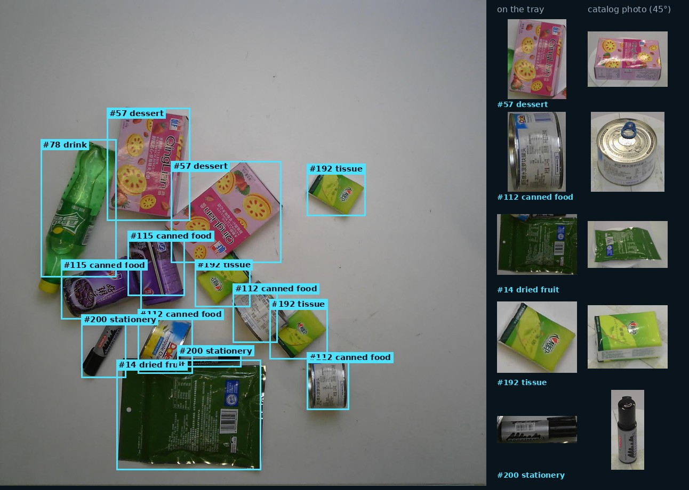
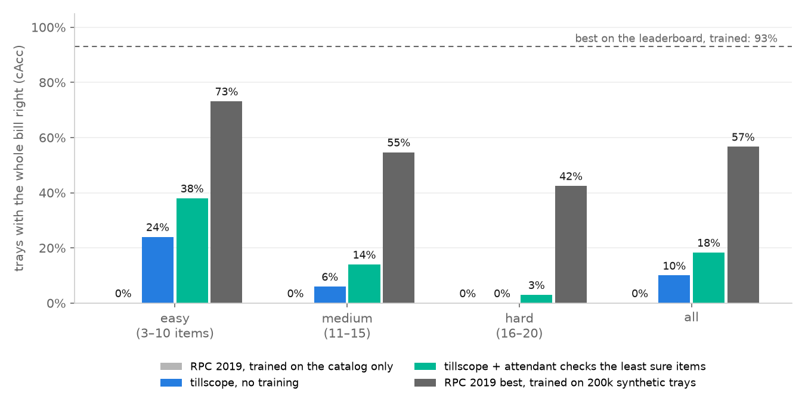
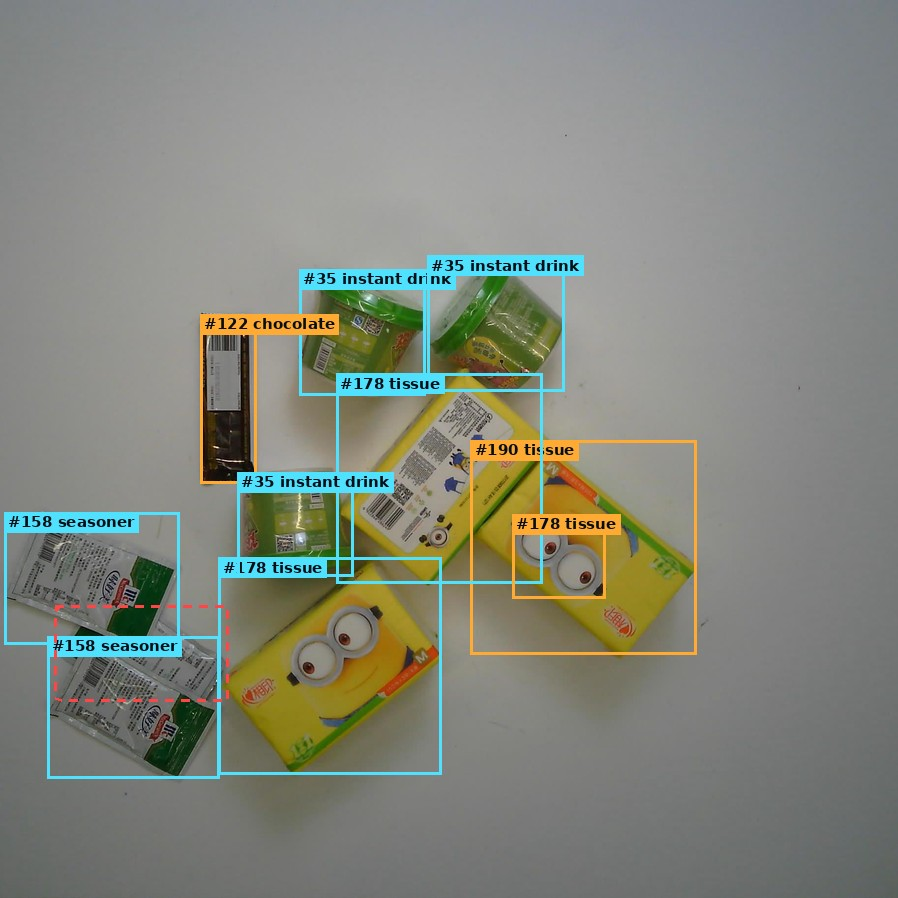
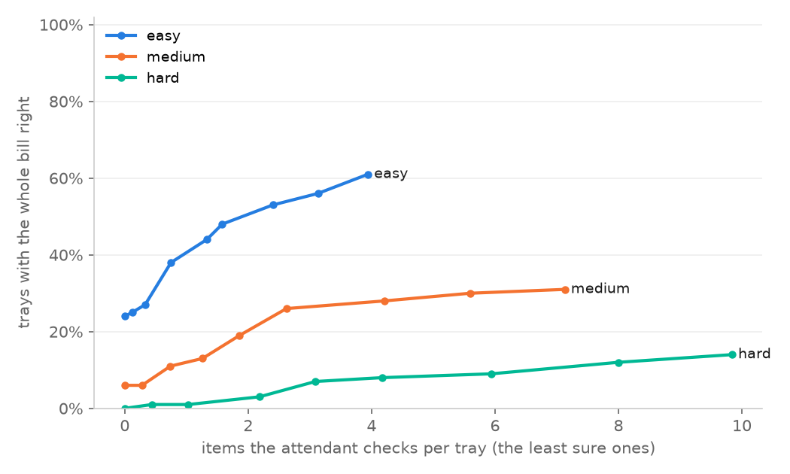
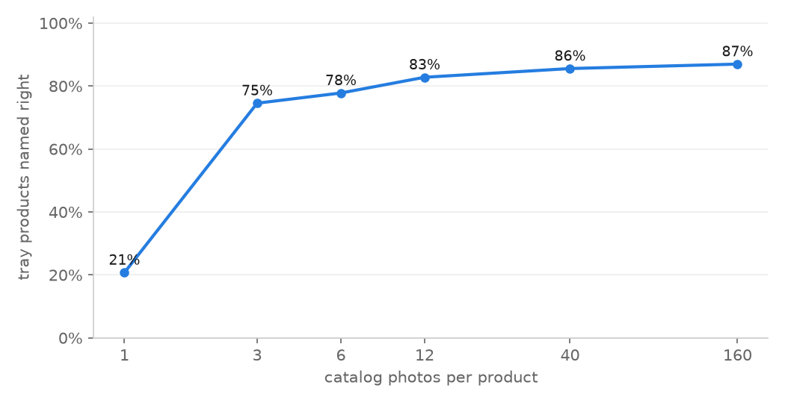
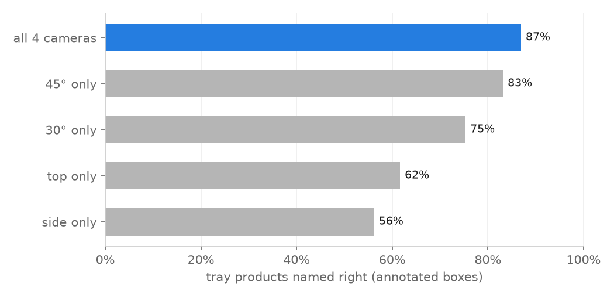
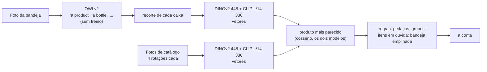

# tillscope: a câmera confere a bandeja do caixa só com as fotos de catálogo?

🌐 [English](README.md) · **Português (Brasil)**

**Uma câmera sobre o caixa, 200 produtos e nenhum treino. Ela acha cada item da bandeja, dá o nome comparando com as fotos de catálogo e monta a conta.**

> Um estudo pessoal de **Claudio Escudero** ([claudioescudero.com](https://claudioescudero.com) · [linkedin.com/in/claudioescudero](https://www.linkedin.com/in/claudioescudero/)). Não é produto nem biblioteca.

<p align="center"></p>
<sub>Uma bandeja média do teste lida certa: 14 produtos, sem treino. À direita, o que a câmera viu e uma foto de catálogo do produto que ela deu como nome. Imagens: dataset RPC, CC BY-NC-SA 4.0.</sub>

**A pergunta:** o autoatendimento e as lojas do tipo "é só pôr no balcão" precisam de uma câmera que saiba o que está na bandeja. O caminho usual é treinar um detector com milhares de fotos de caixa. E se a loja só tivesse as **fotos de catálogo** (cada produto sozinho, em estúdio)? Modelos abertos dariam conta sem treino nenhum, e diriam quando estão em dúvida?

**Resposta curta:** a câmera dá o nome certo a **87% dos produtos** sem ter sido treinada com uma única foto de caixa (90 delas só ajustaram os limiares). Só que a conta só está certa quando *todos* os itens estão, e 87% por item em 13 itens raramente fecha uma conta inteira. Nas 300 bandejas de teste, a conta inteira saiu certa em **10%** das vezes (24% nas bandejas fáceis). O modelo de 2019 treinado com as mesmas fotos de catálogo chegou a 0,01%; os treinados com 200 mil bandejas sintéticas, a 57% e 93%. Duas soluções baratas ajudam: o atendente confere os 1 ou 2 itens de menor certeza por bandeja (18%), e a câmera pede para espalhar os produtos empilhados antes de ler (45% das bandejas que ela aceita saem certas).

## Resultados

Toda escolha (modelos, limiares, a margem do atendente, quando pedir para espalhar os produtos) foi feita em 90 bandejas de validação. Os números são de 300 bandejas de **teste**, 100 por nível de bagunça, com 3.899 produtos.

| | fácil | média | difícil | todas |
|---|---|---|---|---|
| Produtos achados pelo OWLv2 | 92,6% | 91,4% | 88,5% | 90,3% |
| Caixas a mais por bandeja (pedaços, duplicadas) | 0,90 | 2,06 | 3,65 | 2,20 |
| Produtos com o nome certo, com as caixas anotadas | 88,9% | 88,0% | 85,2% | **86,9%** |
| Produtos com o nome certo, pipeline completo | 84,2% | 83,5% | 78,7% | 81,4% |
| Número de itens certo | 50% | 36% | 13% | 33% |
| **Conta inteira certa (cAcc)** | **24%** | **6%** | **0%** | **10%** |
| Conta inteira certa se toda caixa fosse perfeita | 43% | 21% | 8% | 24% |
| Itens que o atendente confere por bandeja | 0,79 | 1,32 | 2,23 | 1,45 |
| Conta inteira certa depois do atendente | 38% | 14% | 3% | 18% |

<p align="center"></p>

**Contra o benchmark do RPC** (cAcc, a fração de bandejas com a conta inteira certa):

| Método | Treinado com | fácil | média | difícil | todas |
|---|---|---|---|---|---|
| RPC 2019, "Single" (artigo, Tabela 3) | as 53.739 fotos de catálogo | 0,02% | 0,00% | 0,00% | 0,01% |
| **tillscope** | nada | 24% | 6% | 0% | 10% |
| tillscope + atendente confere 1,45 item por bandeja | nada | 38% | 14% | 3% | 18% |
| Linha de base do RPC 2019, "Syn+Render" (artigo, Tabela 3) | catálogo + 200 mil bandejas sintéticas | 73,17% | 54,69% | 42,48% | 56,68% |
| CommNet v2, 2021 ([ranking](https://github.com/RPC-Dataset/RPC-Leaderboard)) | catálogo + bandejas sintéticas | | | | 93,11% |

Os protocolos não são idênticos: o tillscope usa uma amostra de 300 bandejas, e os níveis saem da contagem de itens (a cópia da Hugging Face não traz o nível). A distância continua clara: só com as fotos de catálogo, os modelos abertos de hoje superam com folga o detector de 2019 treinado só com o catálogo, mas ainda ficam longe dos modelos treinados com bandejas sintéticas.

### Onde a conta erra

Das 270 bandejas de teste com a conta errada, **177 perderam um produto**, 55 tiveram uma caixa a mais (um pedaço de produto, ou um produto contado duas vezes) e 38 tiveram todas as caixas certas e um nome errado. Com caixas perfeitas, a conta inteira sairia certa em 24% das bandejas, e não em 10%: achar os produtos pesa tanto quanto dar o nome.

<p align="center"></p>
<sub>Ciano: certo. Âmbar: nome errado, ou caixa que não é produto. Vermelho tracejado: produto que a câmera perdeu. Aqui: dois pacotes de lenço da mesma marca trocados, o rosto de desenho de um pacote marcado como produto, e um sachê embaixo de outro perdido.</sub>

Os produtos se perdem sobretudo quando estão **embaixo de outro produto**, quando o saco é transparente e quando são planos (cadernos). Nos nomes errados, 46% vão para um produto do mesmo grupo (por exemplo, o chocolate #133 lido como #131 e o chiclete #137 como #136): o RPC tem variantes muito parecidas da mesma marca. Chocolate (74% certos) e chiclete (76%) são os grupos mais difíceis; bebidas, os mais fáceis (95%).

### O atendente e o "por favor, espalhe os produtos"

<p align="center"></p>

Cada nome vem com uma **margem**: o quanto o melhor produto fica à frente do segundo. O atendente confere os itens de menor margem. Um item conferido ganha o nome certo, e uma caixa conferida que não é produto é apagada. Conferir 10% dos itens (0,8 por bandeja fácil) leva as bandejas fáceis de 24% para 38%; conferir 4 por bandeja, para 61%. Produto perdido não se conserta assim, e por isso as curvas achatam.

Quando uma caixa fica pelo menos metade dentro de outra, há produtos empilhados, e a câmera **pede para espalhá-los** em vez de ler a bandeja. O limiar de 50% foi o que melhor separou, na validação, as contas erradas das certas. O RPC monta bandejas cheias de propósito, então a regra devolve a maioria: ela aceita 24% das bandejas de teste (46% das fáceis), e nessas a conta sai certa em 45% das vezes depois do atendente, contra 18% no total.

### O que dá melhor o nome de um produto

Produtos com o nome certo nas bandejas de teste, usando as caixas anotadas (para a detecção não atrapalhar):

| Vetores | 12 fotos de catálogo por produto | Catálogo inteiro (~270 por produto) |
|---|---|---|
| DINOv2 base, 224 px | 59,4% | |
| DINOv2 large / giant, 224 px | 59,3% / 57,6% | |
| DINOv2 base / large, 448 px | 66,5% / 66,7% | 71,4% (base) |
| CLIP ViT-B/32 | 69,1% | |
| CLIP ViT-L/14-336 | 76,8% | 83,4% |
| **DINOv2 base 448 + CLIP L/14-336** | 83,2% | **86,9%** |

- **O CLIP ganhou do DINOv2**, o contrário do [skuscope](https://github.com/escudero/skuscope), em que o DINOv2 separava produtos parecidos na foto de uma gôndola. Aqui o catálogo é um estúdio e a bandeja é outra cena, com outra luz e outro ângulo. O CLIP, que aprendeu com legendas, aguenta melhor essa mudança. Os dois juntos ganham de cada um sozinho: eles erram produtos diferentes.
- **No DINOv2, a resolução importou e o tamanho não.** Passar de 224 para 448 px rendeu 7 pontos (letras pequenas e logos); passar do base para o giant, nada.
- **Girar as fotos de catálogo** em 90°, 180° e 270° rendeu 4 pontos (86,9% contra 83,2%): na bandeja, os produtos ficam em qualquer ângulo.

<p align="center">
  
  
</p>

- **Mais fotos de catálogo, nomes melhores:** com 1 foto por produto, 21% dos produtos saem com o nome certo; com 12, 83%; com 160 ou mais, 87%.
- **A câmera de cima não é a melhor.** Uma das quatro câmeras do catálogo olha de cima para baixo, como a do caixa, mas sozinha acerta só 62%. No prato giratório a garrafa fica em pé, e de cima ela é uma tampa; na bandeja ela fica deitada e se parece com a vista de lado. Só a câmera de 45° acerta 83%, e as quatro juntas, 87%.

## O que deu errado

| Achado | O que mudou |
|---|---|
| A ideia supunha que o catálogo era todo de lado; uma das quatro câmeras do RPC olha de cima | Virou um teste: a câmera de cima sozinha é pior que a de 45°, e as quatro juntas são as melhores |
| O DINOv2 base deu o nome certo a 59% dos produtos, e a conta saiu certa em menos de 8% das bandejas de validação | CLIP, 448 px, o par e o catálogo inteiro: 87% |
| Um DINOv2 maior (giant, 1,1 bilhão de parâmetros) não ajudou | A resolução, sim |
| O OWLv2 marcou pedaços de produtos (o rosto de desenho num pacote) e grupos de produtos | Uma caixa que contém duas caixas de que ele tem menos certeza é um grupo e sai; uma caixa de menos certeza dentro de outra com o mesmo nome é um pedaço e sai |
| Produtos embaixo de outros se perdem, e um item a menos estraga a conta | O detector não resolveu: a câmera pede para espalhar os produtos |
| O OWLv2 perde cadernos planos ("a product" e "a package" não cobrem) | Acrescentar "a notebook", "a pen", "a tube" e "a pouch" reduziu à metade a papelaria perdida na validação (16 → 8), mas subiu o recall geral só 0,7 ponto; os 8 prompts ficaram |
| O score de "objectness" do OWLv2, sem classe, para achar os produtos | Pior que os prompts de texto em 15 bandejas de validação: não foi usado |
| A API de linhas da Hugging Face respondeu 429 depois de uma rajada de downloads de fotos (os links das fotos também contam) | Uma requisição a cada 0,4 s, com o token da Hugging Face quando há um |
| O RPC fotografa cada cesta duas ou três vezes, rearranjada | Uma foto por cesta na amostra |
| O notebook teve só ~0,7 GB de memória livre em alguns momentos | A detecção e os primeiros vetores rodaram na CPU dele; os modelos maiores e o catálogo inteiro rodaram numa T4 grátis do Kaggle |

## Os dados

| Dados | O que o estudo usa | Download | Licença |
|---|---|---|---|
| [RPC, Retail Product Checkout](https://rpc-dataset.github.io/) ([arXiv 1901.07249](https://arxiv.org/abs/1901.07249)) | 2.400 fotos de catálogo (12 por produto: 3 de cada uma das 4 câmeras) e 390 bandejas (90 de validação e 300 de teste), ~0,4 GB; nas rodadas com o catálogo inteiro, as 53.739 fotos de catálogo (9,2 GB, lidas no Kaggle) | A cópia livre na Hugging Face [`benjamintli/retail-product-checkout`](https://huggingface.co/datasets/benjamintli/retail-product-checkout), foto a foto, com o [`01_fetch.py`](scripts/01_fetch.py) | CC BY-NC-SA 4.0 |

O RPC tem 200 produtos de 17 grupos (bebidas, macarrão instantâneo, lenços, balas...), fotografados de dois jeitos:

- **Catálogo:** um produto por vez num prato giratório, por quatro câmeras (de lado, 30°, 45° e de cima), a cada 9°; caixas e sacos duas vezes, uma por lado. São 53.739 fotos no total.
- **Caixa:** uma câmera sobre uma placa branca de 80 × 80 cm, com 3 a 20 produtos jogados sobre ela. São 30 mil bandejas em três níveis de bagunça, cada produto anotado com a caixa e o nome.

Três detalhes dos dados moldaram o estudo:

- **A cópia da Hugging Face não traz o nível de bagunça.** O RPC o define pelo número de itens por bandeja (fácil 3–10, médio 10–15, difícil 15–20); as faixas se encostam, então as bandejas são separadas pela contagem: fácil ≤ 10, médio 11–15, difícil ≥ 16.
- **Cada cesta foi fotografada duas ou três vezes**, rearranjada na placa. A amostra fica com uma foto por cesta, para nenhuma compra contar duas vezes.
- **Os nomes dos produtos são anônimos** (`35_instant_drink`), por isso as imagens mostram números.

## Como funciona



1. **Achar.** O OWLv2 é um detector de vocabulário aberto: acha objetos a partir de textos, aqui "a product", "a package", "a bottle", "a box", "a bag", "a cup", "a chocolate bar" e "a can". Nada sobre estes 200 produtos é ensinado a ele.
2. **Impressão digital.** Cada caixa é recortada (com 4% em volta), completada até virar um quadrado e transformada em dois vetores, um pelo DINOv2 em 448 px e outro pelo CLIP ViT-L/14 em 336 px. Cada foto de catálogo é recortada pela caixa do RPC do mesmo jeito, em quatro rotações.
3. **Nome.** Cada recorte é comparado com todas as fotos de catálogo por similaridade de cosseno; a nota de um produto é a da sua melhor foto. As notas dos dois modelos vão para uma escala só (cada uma padronizada pela média e pelo desvio na validação) e viram uma média. A distância entre o melhor e o segundo produto é a **margem**.
4. **Limpeza.** Uma caixa que contém duas ou mais caixas de que o OWLv2 tem mais certeza é um grupo e sai. Uma caixa de menos certeza dentro de uma caixa maior com o mesmo nome é um pedaço e sai. Uma caixa dentro de outra com nome *diferente* fica: é um produto em cima de outro. Uma caixa de que o OWLv2 tem pouca certeza (abaixo de 0,3) ainda conta quando se parece muito com um produto do catálogo.
5. **Conta.** Contam-se os nomes. Os itens com margem abaixo do limiar da validação vão para o atendente; a bandeja em que uma caixa fica metade dentro de outra volta para ser espalhada.

| Modelo | Papel | Treinado com |
|---|---|---|
| **OWLv2** base, patch 16, ensemble ([`google/owlv2-base-patch16-ensemble`](https://huggingface.co/google/owlv2-base-patch16-ensemble)) | Achar cada produto a partir de textos | Base do CLIP, depois autotreino em imagens da web (WebLI) com caixas geradas pelo próprio modelo, mais datasets públicos de detecção |
| **DINOv2** base ([`facebook/dinov2-base`](https://huggingface.co/facebook/dinov2-base)), em 448 px | Vetores que veem o detalhe visual | LVD-142M, só imagens (autossupervisionado) |
| **CLIP** ViT-L/14-336 ([`openai/clip-vit-large-patch14-336`](https://huggingface.co/openai/clip-vit-large-patch14-336)) | Vetores que veem o que o objeto é | 400 milhões de pares imagem–texto |
| Comparados, mas não usados no fim | DINOv2 large e giant ([`facebook/dinov2-large`](https://huggingface.co/facebook/dinov2-large), [`facebook/dinov2-giant`](https://huggingface.co/facebook/dinov2-giant)), CLIP ViT-B/32 ([`openai/clip-vit-base-patch32`](https://huggingface.co/openai/clip-vit-base-patch32)) | |

Todos são prontos; nenhum foi treinado nem ajustado para este estudo.

## Como reproduzir

**Requisitos:** Linux ou macOS, Python 3.12 e [uv](https://docs.astral.sh/uv/). O catálogo de 12 fotos roda na CPU; o catálogo inteiro pede uma GPU.

```bash
# 1. ambiente (PyTorch para CPU; numa máquina com GPU, use a versão CUDA)
uv venv --python 3.12 .venv && source .venv/bin/activate
uv pip install -r requirements.txt --extra-index-url https://download.pytorch.org/whl/cpu

# 2. dados (~0,4 GB)
python scripts/01_fetch.py index      # rótulos das 83.739 linhas, só JSON (~45 min, com pausas)
python scripts/01_fetch.py select     # 12 fotos de catálogo por produto, 390 bandejas
python scripts/01_fetch.py download   # as fotos (~40 min, com pausas)

# 3. o estudo
python scripts/02_detect.py                              # OWLv2: 4,6 s por bandeja numa CPU de 16 threads
python scripts/03_embed.py dinov2-448 clip-large-336     # vetores de cada recorte (GPU: ~25 min numa T4)
python scripts/03b_embed_full_catalog.py dinov2-448      # opcional, o catálogo inteiro (T4: 99 min)
python scripts/03b_embed_full_catalog.py clip-large-336  # opcional (T4: 126 min)
python scripts/04_recognize.py                           # escolhas na validação, as contas
python scripts/05_evaluate.py                            # os números, no teste
python scripts/06_figures.py                             # as imagens deste README
```

O `03_embed.py` sem nomes roda todos os modelos da tabela de comparação. Os modelos são baixados da Hugging Face no primeiro uso (OWLv2 0,62 GB, DINOv2 base 0,35 GB, CLIP L/14-336 1,7 GB). A API de linhas responde 429 quando pressionada, então o `01_fetch.py` controla o ritmo (uma requisição a cada 0,4 s) e usa o seu token da Hugging Face quando você está logado (`hf auth login`). O `03b_embed_full_catalog.py` lê os 19 arquivos Parquet do catálogo (9,2 GB) um por vez e apaga cada um depois do uso; ele precisa do `pyarrow`. A saída fica em `data/output/`.

**Numa GPU grátis do Kaggle:** o [`scripts/kaggle/run_on_kaggle.py`](scripts/kaggle/run_on_kaggle.py) sobe os scripts, os rótulos e as fotos já baixadas como um dataset privado, roda o passo 3 (ou o 3b, com `--full <modelo>`) num notebook privado numa T4, espera e baixa os vetores. Ele precisa da CLI do Kaggle com as suas credenciais. Neste estudo, os passos 1 e 2 e os vetores do DINOv2 base e do CLIP B/32 rodaram na CPU de um notebook; os outros vetores rodaram no Kaggle.

### Para usar nas suas fotos

O [`scripts/tillscope.py`](scripts/tillscope.py) roda o pipeline inteiro nas suas fotos de catálogo e de bandeja. Ele só precisa do ambiente; os limiares vêm do `data/output/config.json` quando você rodou o estudo, senão dos valores do estudo.

```bash
# uma pasta por produto, algumas fotos de cada, de vários ângulos (45° é o que mais ajuda)
python scripts/tillscope.py build-catalog meu_catalogo/ --out meu_catalogo.npz

# lê uma bandeja; com --expect, compara com o que passou no caixa (um nome de produto por linha)
python scripts/tillscope.py check bandeja.jpg --catalog meu_catalogo.npz --expect cupom.txt --out conferida.jpg
```

Um exemplo honesto: uma bandeja de teste com 5 produtos, um catálogo com as 12 fotos do RPC de cada um, o par mais leve (`--models dinov2+clip`) e o cupom certo:

```
5 products on the tray
  3 x 107_milk
  1 x 13_dried_fruit
  1 x 147_candy
! on the tray but not rung up: 1 x 107_milk
! rung up but not seen on the tray: 1 x 170_personal_hygiene
```

A caixa de creme dental (`170`) foi lida como uma caixinha de leite, e um cupom certo disparou um alarme falso. É o caso do atendente: no `conferida.jpg`, os itens de margem pequena aparecem em âmbar para ser confirmados. Quando os produtos estão empilhados, ele pede para espalhá-los.

## Organização do repositório

```
scripts/
  01_fetch.py … 06_figures.py   reproduzem o estudo, um passo cada, parâmetros no topo
  03b_embed_full_catalog.py     opcional: vetores do catálogo inteiro (GPU)
  tray.py                       nome, regras de limpeza, conta e pareamento (compartilhado)
  tillscope.py                  para usar no seu catálogo e nas suas fotos de bandeja
  kaggle/                       opcional: passo 3 ou 3b numa GPU do Kaggle
docs/media/                     as imagens deste README
```

## Limitações

- Um dataset, uma montagem: 200 produtos chineses, uma altura de câmera, uma placa branca e fotos de catálogo de estúdio. Uma loja de verdade tem outra luz, outros balcões e milhares de produtos.
- 300 bandejas de teste, com os níveis tirados da contagem de itens; os níveis do próprio RPC e as suas 24 mil bandejas de teste dariam números um pouco diferentes.
- O atendente é simulado: um item conferido ganha o nome certo, e uma caixa conferida que não é produto é apagada. Produto perdido continua perdido.
- A regra de espalhar os produtos é medida, não executada: no RPC não dá para rearrumar uma bandeja, então o estudo mostra o quanto acertam as bandejas que ela aceita.
- A fraude (um item trocado ou não registrado) fica para uma próxima versão; o `tillscope.py --expect` já compara a bandeja com um cupom.
- Os vetores do catálogo inteiro pedem GPU (cerca de 4 h numa T4 para os dois modelos), e só o CLIP L/14-336 tem 1,7 GB.

## Créditos e licenças

- **Código:** © 2026 Claudio Escudero, [CC BY-NC 4.0](LICENSE), só uso não comercial.
- **Dados:** [RPC](https://rpc-dataset.github.io/) (Wei, Cui, Yang, Wang e Liu, *RPC: A Large-Scale Retail Product Checkout Dataset*, 2019), CC BY-NC-SA 4.0, pela cópia da Hugging Face de `benjamintli`. As imagens de bandeja e de catálogo em `docs/media/` são adaptadas do RPC e continuam CC BY-NC-SA 4.0.
- **Modelos:** OWLv2 (Minderer, Gritsenko e Houlsby, *Scaling Open-Vocabulary Object Detection*, NeurIPS 2023, Apache-2.0), DINOv2 (Oquab et al., 2023, Apache-2.0) e CLIP (Radford et al., 2021, MIT), todos pelo 🤗 Transformers. Os pesos são baixados dos autores, não redistribuídos.
- **Números de comparação:** o artigo do RPC (Tabela 3) e o [ranking do RPC](https://github.com/RPC-Dataset/RPC-Leaderboard) (CommNet v2).
- **Estudo irmão:** [skuscope](https://github.com/escudero/skuscope), a mesma ideia de "achar e depois dar o nome pelas fotos de catálogo", nas gôndolas.
